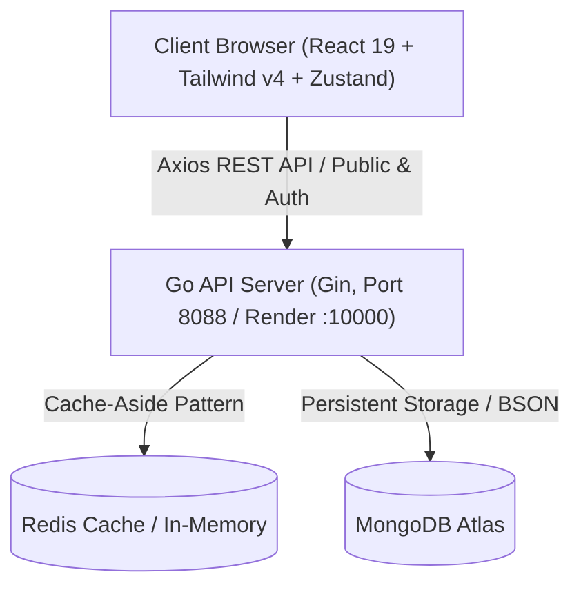

# 🤖 AGENTS & DEVELOPER CONTEXT: BÁNH TRÁNG CẬU HAI

> **Tài liệu ngữ cảnh dành cho AI Coding Assistants (Antigravity, Cursor, Copilot, Claude Code) & Lập trình viên mới.**
> File này cung cấp toàn bộ bức tranh kiến trúc, quy chuẩn công nghệ, nguyên tắc bảo mật và logic nghiệp vụ cốt lõi của dự án.

---

## 📌 1. TỔNG QUAN DỰ ÁN (PROJECT OVERVIEW)
- **Tên dự án**: **Bánh Tráng Cậu Hai** (Member Shop F&B Platform).
- **Mô hình**: Hệ thống thương mại điện tử F&B 2-trong-1 (Dual-Platform):
  1. **Storefront (Kênh khách hàng)**: Xem thực đơn, tùy chọn độ cay/topping, đặt hàng Zalo, tích điểm tự động theo Số Điện Thoại, tra cứu thẻ hội viên realtime.
  2. **Merchant Portal & POS (Kênh quản trị & quầy)**: Quản lý món, bật/tắt tồn kho, chốt két giao ca, phân ca làm việc, chấm công bảng lương, duyệt đơn và cấu hình cửa hàng.
- **Trang web Live Production**: `https://member-shop-ui.vercel.app`
- **Backend API Production**: `https://member-shop-api.onrender.com`

---

## 🛠️ 2. TECH STACK & SYSTEM ARCHITECTURE



### A. Frontend (`member-shop-ui`)
- **Core**: React 19, TypeScript, Vite 8.
- **Styling**: Tailwind CSS v4, Lucide React icons, Canvas Confetti.
- **State Management**: **Zustand** (`src/stores/useShopStore.ts`):
  - Quản lý tập trung: `shopConfig`, `products`, `vouchers`.
  - Cơ chế **Singleton In-Memory Cache** + **In-Flight Request Deduplication**: Chỉ gọi `GET /v1/config` đúng 1 lần duy nhất khi khởi tạo trang; tuyệt đối không gọi lại khi chuyển tab hay remount.
- **HTTP Client** (`src/services/api/httpClient.ts`):
  - Phân tách `publicApi` (không đính kèm token) và `authApi` (tự động inject Bearer Access Token).
  - Tự động fallback sang Live API trên Render khi chạy trên domain `*.vercel.app`.
  - Concurrency Refresh Mutex: Tự động xếp hàng các request 401 để chỉ gọi đúng 1 lần refresh token khi token hết hạn.

### B. Backend (`member-shop-api`)
- **Core**: Go 1.24, Gin Web Framework.
- **Architecture**: Clean Architecture (Handler ➔ Service ➔ Repository ➔ Model).
- **Database**: MongoDB Atlas qua `go.mongodb.org/mongo-driver/v2`.
- **Caching**: Cache-Aside Pattern (Redis với High-performance In-Memory Fallback).
- **Security & Auth**:
  - Mã PIN băm chuẩn `bcrypt` (không bao giờ lưu plaintext).
  - JWT ECDSA ES256 cho Access Token (thời hạn 15 phút).
  - Refresh Token opaque (64-byte hex) lưu an toàn trong **HttpOnly Cookie**.
  - Rate Limiter chống Brute-Force: Tự động khóa tạm 15 phút nếu nhập sai mã PIN 5 lần liên tiếp.

---

## 💎 3. QUY TẮC NGHIỆP VỤ CỐT LÕI (CORE BUSINESS RULES)

1. **Chính Sách Tích Điểm & Hoàn Tiền**:
   - Tỷ lệ tích điểm: **10.000 VNĐ** chi tiêu = **1 Điểm Thưởng** (`spendToPointRatio`).
   - Tỷ lệ quy đổi tiền mặt: **1 Điểm Thưởng** = **500 VNĐ** trừ trực tiếp vào hóa đơn (`pointToVndRatio`).
   - Tương đương hoàn tiền từ **5.0% đến 7.5%** tổng hóa đơn tùy theo hạng thẻ.
2. **Bảng 4 Hạng Thẻ Hội Viên (`TIER_CONFIG`)**:
   - **Hội Viên Thân Thiết (MEMBER)**: Chi tiêu từ `0đ` | Hệ số tích điểm `x1.0`.
   - **Hội Viên Bạc (SILVER)**: Chi tiêu tích lũy từ `200.000đ` | Hệ số tích điểm `x1.15`.
   - **Hội Viên Vàng (GOLD)**: Chi tiêu tích lũy từ `600.000đ` | Hệ số tích điểm `x1.3`.
   - **VIP Kim Cương (DIAMOND)**: Chi tiêu tích lũy từ `1.500.000đ` | Hệ số tích điểm `x1.5`.
3. **Quy Tắc Đổi Điểm An Toàn (SEC-06)**:
   - Trừ điểm nguyên tử (Atomic Deduction) tại DB bằng điều kiện `availablePoints >= pointsToDeduct`. Chống triệt để Race Condition / Double Spending.
4. **Kiểm Soát Phiên Bản (Optimistic Concurrency Control - OCC)**:
   - Khi cập nhật sản phẩm/cấu hình/ca làm, chỉ gửi các trường thực sự thay đổi kèm theo `version`. Nếu phiên bản không khớp thì báo xung đột để nạp lại dữ liệu mới nhất.
5. **Chuẩn Phân Trang (Pagination)**:
   - Mọi danh sách (danh mục món, đơn hàng, hội viên, giao dịch điểm) đều bắt buộc trả về metadata phân trang (`page`, `pageSize`, `total`, `totalPages`).

---

## 🚀 4. HƯỚNG DẪN KHỞI CHẠY (QUICK START GUIDE)

### Lựa chọn 1: Chỉ chạy Frontend (Nhanh nhất - Không cần cài Go/MongoDB)
Frontend đã cấu hình sẵn để tự động kết nối với Live API trên Render:
```bash
git clone https://github.com/Thiennn262626/member-shop-ui.git
cd member-shop-ui
npm install
npm run dev
# Mở trình duyệt: http://localhost:5173
```

### Lựa chọn 2: Chạy đầy đủ cả Frontend và Backend Go Local
1. **Chạy Backend**:
   ```bash
   cd member-shop-api
   # Tạo file .env từ .env.example và điền MONGODB_URI
   go run cmd/api/main.go
   # Server lắng nghe tại: http://localhost:8088
   ```
2. **Chạy Frontend**:
   ```bash
   cd member-shop-ui
   npm run dev
   ```

---

## 👥 5. QUY ƯỚC LÀM VIỆC & PHỐI HỢP (CONTRIBUTION GUIDELINES)
- **Git Branching**: Tuyệt đối không commit trực tiếp vào `main`. Hãy tạo nhánh `feature/<ten-tinh-nang>` hoặc `bugfix/<ten-loi>`.
- **Commit Messages**: Tuân thủ chuẩn Conventional Commits:
  - `feat(ui): ...`
  - `fix(order): ...`
  - `refactor(store): ...`
  - `style(theme): ...`
- **Bảo Mật**: Tuyệt đối không commit file `.env`, mật khẩu, Private Key hay mã PIN quản trị lên GitHub.
