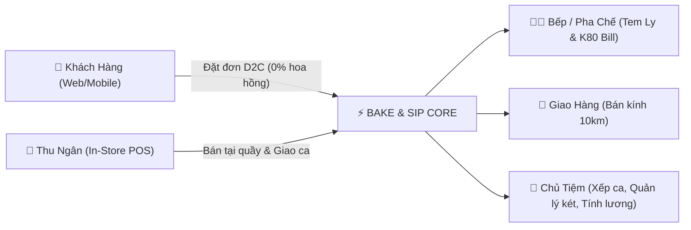
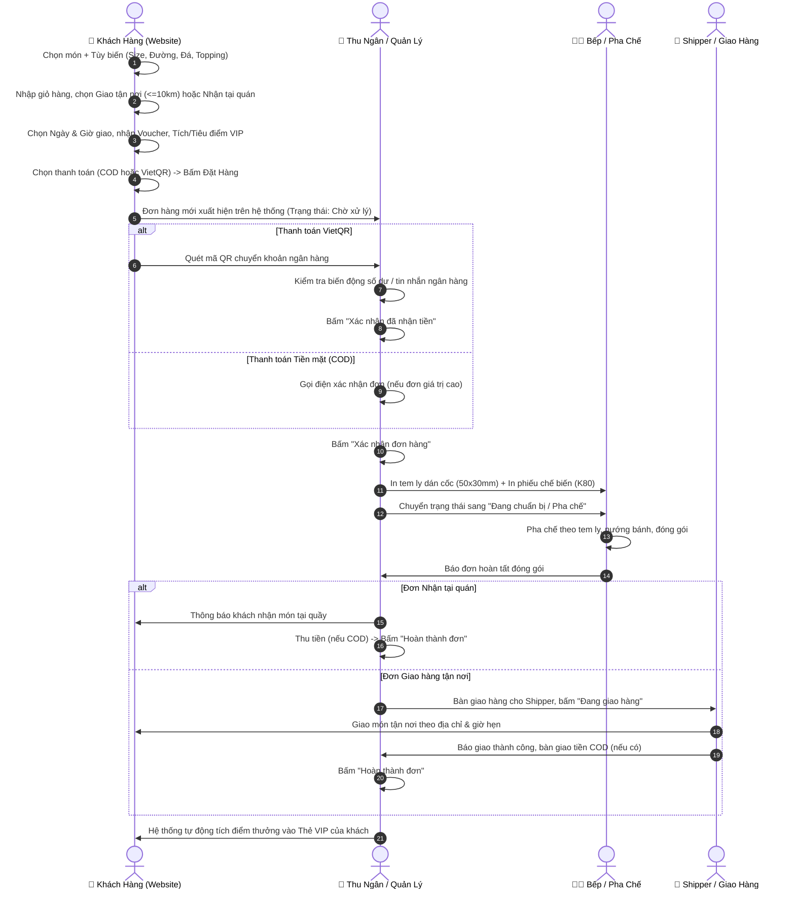

# 📑 TÀI LIỆU TOÀN DIỆN HỆ THỐNG VẬN HÀNH BÁN HÀNG & F&B POS - BAKE & SIP
> **Hồ sơ Thuyết minh Năng lực Sản phẩm & Hướng dẫn Vận hành Nghiệp vụ Thực tế**  
> *Dành cho Quý Nhà Đầu Tư, Đối Tác Chiến Lược & Ban Quản Lý Dự Án*

---

## 🎯 PHẦN 1: TỔNG QUAN DỰ ÁN & GIẢI PHÁP ĐỘT PHÁ (EXECUTIVE SUMMARY)

### 1.1. Bối cảnh thị trường & Bài toán thực tế của ngành F&B
Tại thị trường đồ uống & bánh ngọt hiện nay, các cửa hàng vừa và nhỏ (SME) đối mặt với 5 "nỗi đau" lớn bào mòn lợi nhuận và hiệu quả vận hành:
1. **Phí hoa hồng quá cao từ các app giao hàng bên thứ ba (20% – 30%)**: Khiến biên lợi nhuận của quán bị bóp nghẹt; khách hàng bị phụ thuộc vào nền tảng khác mà quán không nắm giữ được dữ liệu người mua.
2. **Thất thoát dòng tiền khi giao ca thủ công**: Thu ngân ghi chép sổ sách hoặc dùng bảng tính rời rạc, dẫn đến khó kiểm soát lượng tiền mặt thực tế trong két so với số liệu bán ra.
3. **Xung đột ca làm việc và lãng phí thời gian tính lương**: Nhân viên F&B thường làm ca linh hoạt (part-time, xoay ca, tăng ca, nghỉ đột xuất). Chủ tiệm mất hàng chục giờ mỗi cuối tháng để đối soát số giờ làm việc, dễ xảy ra tranh chấp lương.
4. **Trải nghiệm khách hàng đứt gãy do không đồng bộ kho món**: Khách đặt món trên web nhưng khi pha chế lại báo hết topping hoặc hết bánh, dẫn đến hủy đơn và mất khách.
5. **Thiếu hệ thống giữ chân khách hàng (Loyalty & VIP Membership)**: Khách mua xong không quay lại vì không có chương trình tích điểm, phân hạng thành viên tự động.

### 1.2. Giải pháp: Nền tảng Hợp nhất Bake & Sip (All-in-One Dual-Platform)
**Bake & Sip** được thiết kế dưới kiến trúc **kép 2-trong-1 (Dual-Interface)**:
- **Kênh Khách Hàng (Customer Storefront - D2C Web App)**: Khách hàng tự trải nghiệm menu, tùy biến đồ uống (size, đường, đá, topping), kiểm tra phí ship nấc thông minh trong bán kính 10km, hẹn giờ giao hàng, quét mã VietQR tự động và tra cứu hành trình đơn hàng mà không cần cài app phức tạp.
- **Kênh Vận Hành Bán Hàng & Quản Trị (Store Management & In-Store POS)**: Dành riêng cho thu ngân và chủ tiệm với quy trình khép kín: POS chạm nhanh tại quầy, in bill nhiệt K80 và in tem dán ly 50x30mm, quản lý đơn bếp trực quan, giao ca chốt két chống thất thoát, bật/tắt món hết tức thì, và **tờ lịch phân ca thông minh 1-click chống trùng ca cùng bảng tính lương tự động**.

---

## 🖥️ PHẦN 2: CHI TIẾT CÁC TÍNH NĂNG GIAO DIỆN (UI/UX BREAKDOWN)

### A. PHÂN HỆ KHÁCH HÀNG (CUSTOMER STOREFRONT)

#### 1. Header & Điều hướng thông minh
- **Nhận diện thương hiệu & Hotline**: Hiển thị tên quán, slogan, nút gọi nhanh hotline đặt tiệc / hỗ trợ.
- **Nút Tra cứu đơn hàng**: Mở modal nhập mã đơn (`#BS-xxxx`) hoặc số điện thoại để xem trực tiếp tiến độ đơn theo thời gian thực.
- **Nút Thẻ VIP thành viên**: Khách nhập số điện thoại để tra cứu ngay hạng thẻ (Đồng, Bạc, Vàng, Kim Cương), điểm thưởng hiện có và đặc quyền giảm giá của mình.
- **Giỏ hàng nổi bật**: Hiển thị huy hiệu số lượng món đang có trong giỏ hàng; cập nhật hiệu ứng chuyển động mượt mà khi thêm món.
- **Cổng đăng nhập Quản lý (Admin Entry)**: Nút chuyển sang giao diện người bán, bảo vệ bằng mã PIN / tài khoản.

#### 2. Hero Section & Banner Trải nghiệm
- Hình ảnh món đặc trưng bắt mắt, kích thích vị giác.
- Nút kêu gọi hành động (CTA) "Đặt Hàng Ngay" cuộn mượt xuống danh mục menu.
- Các cam kết chất lượng: "Nguyên liệu tươi mới trong ngày", "Giao nhanh khu vực 10km", "Tích điểm đổi quà tự động".

#### 3. Menu tương tác & Tùy biến món (Product Catalog & Customizer)
- **Danh mục trượt ngang linh hoạt**: Phân loại rõ ràng (Tất cả món, Cà phê & Trà tươi, Bánh ngọt & Bánh nướng, Đá xay & Sinh tố, Topping đặc biệt).
- **Bộ lọc tìm kiếm tức thì**: Tìm nhanh tên món theo từ khóa.
- **Huy hiệu sản phẩm**: Gắn nhãn `Bán Chạy (Best Seller)`, `Mới (New)`, giảm giá.
- **Hiển thị trạng thái hết hàng tức thời**: Nếu một món bị tắt trong trang quản trị, thẻ món ngoài storefront sẽ chuyển sang màu xám nhạt với nhãn `Tạm hết hàng`, vô hiệu hóa nút thêm món nhằm ngăn chặn việc đặt hàng thất bại.
- **Modal tùy biến chi tiết món (Item Customizer Popup)**:
  - Chọn Kích cỡ (Size): Size M (tiêu chuẩn), Size L (+giá tiền).
  - Chọn Độ ngọt: 0%, 30%, 50%, 70%, 100% đường.
  - Chọn Mức đá: Nóng (không đá), 0% đá, 50% đá, 100% đá.
  - Chọn Topping đa dạng: Trân châu trắng, Thạch củ năng, Kem phô mai macchiato, Hạnh nhân nướng... (tự động cộng dồn giá tức thì).
  - Ô nhập ghi chú riêng cho thợ pha chế (ví dụ: *"cho riêng đá", "nhiều kem cheese"*).

#### 4. Ngăn kéo Giỏ hàng & Thanh toán (Cart Drawer)
- **Danh sách món chi tiết**: Liệt kê rõ từng món, size đã chọn, độ ngọt, mức đá, các loại topping kèm theo; nút tăng/giảm số lượng và xóa món.
- **Hình thức nhận hàng linh hoạt**:
  - 🏪 **Nhận tại quán (Takeaway / Pick-up)**: Khách ghé tiệm lấy, chỉ cần nhập tên và SĐT liên hệ, phí giao hàng = 0đ.
  - 🛵 **Giao hàng tận nơi (Bán kính 10km)**:
    - Ô nhập địa chỉ giao nhận chi tiết và số điện thoại người nhận.
    - **Hẹn thời gian giao hàng**: Tùy chọn giao ngay hoặc chọn **Ngày giao + Giờ giao cụ thể** (rất tiện lợi cho khách đặt bánh sinh nhật hoặc đồ uống cho cuộc họp công ty).
    - **Cơ chế Phí Giao Hàng Nấc Đồng Giá (Tiered Shipping Fee <= 10km)**: Áp dụng theo tổng giá trị giỏ hàng:
      - Đơn dưới 100.000đ: Phí ship đồng giá 20.000đ.
      - Đơn từ 100.000đ – 200.000đ: Phí ship ưu đãi 10.000đ.
      - Đơn từ 200.000đ trở lên: **Miễn phí giao hàng (Freeship)**.
- **Hệ thống Mã Giảm Giá (Voucher Promotion)**:
  - Khách hàng nhập mã khuyến mãi (ví dụ: `BANKSIP20`, `WELCOME`).
  - Hệ thống kiểm tra điều kiện giá trị đơn tối thiểu và thời gian hiệu lực, tính toán số tiền giảm trừ (tối đa theo quy định của voucher).
- **Tích & Sử dụng Điểm thưởng Thành viên**:
  - Nhập SĐT để nhận diện hạng thẻ và số dư điểm tích lũy (1 điểm = 1.000đ).
  - Cho phép khách chọn dùng điểm thưởng để giảm trực tiếp vào số tiền cần thanh toán.
- **Tóm tắt đơn hàng minh bạch**: Hiển thị rõ: Tiền tạm tính + Phí giao hàng - Giảm giá voucher - Điểm thưởng = **Tổng tiền thanh toán cuối cùng**.
- **Phương thức thanh toán**:
  - `Tiền mặt khi nhận hàng (COD)`.
  - `Chuyển khoản VietQR`: Tự động tạo mã QR động ngân hàng chuẩn Napas247 đi kèm mã đơn hàng và số tiền chính xác.

#### 5. Màn hình Đặt hàng thành công & Thanh toán VietQR (Order Success Modal)
- Thông báo xác nhận đơn tức thì với Mã đơn hàng định dạng `#BS-xxxx`.
- **Mã QR chuyển khoản ngân hàng động**: Khách chỉ cần mở app ngân hàng bất kỳ (Vietcombank, MBBank, Techcombank, Momo...) quét mã là thông tin tài khoản, số tiền và nội dung chuyển khoản tự động khớp 100%.
- Hiển thị thông báo trạng thái đơn hàng hiện tại: `Chờ quán xác nhận`.
- Nút bấm xem ngay tiến độ đơn hàng hoặc quay lại trang chủ.

#### 6. Tra cứu tiến trình đơn hàng (Order Tracking Modal)
- Theo dõi vòng đời đơn hàng qua sơ đồ Timeline trực quan:
  `Đã đặt` ➔ `Quán xác nhận` ➔ `Đang pha chế & đóng gói` ➔ `Đang giao hàng` ➔ `Đã hoàn thành`.
- Cung cấp thông tin tài xế, thời gian dự kiến giao và chi tiết các món trong đơn.

#### 7. Thẻ thành viên VIP kỹ thuật số (Digital Membership Modal)
- Tra cứu nhanh bằng số điện thoại không cần đăng ký tài khoản rườm rà.
- Hiển thị thẻ VIP với màu sắc theo cấp độ: Đồng (Bronze), Bạc (Silver), Vàng (Gold), Kim Cương (Diamond).
- Thống kê tổng chi tiêu tích lũy, số điểm hiện có, lịch sử tích/tiêu điểm và tỷ lệ giảm giá đặc quyền.

---

### B. PHÂN HỆ BÁN LẺ TẠI QUẦY (IN-STORE POS COUNTER)

Dành cho Thu ngân & Chủ tiệm thực hiện bán hàng trực tiếp tại quầy nhanh chóng trong giờ cao điểm:
- **Giao diện cảm ứng toàn màn hình (Touch-friendly)**: Bố cục lưới món khoa học, hình ảnh to rõ, phân loại theo nhóm đồ uống/bánh.
- **Thanh tìm kiếm và phím tắt thao tác nhanh**: Tìm món theo tên hoặc gõ mã sản phẩm trong vòng 1 giây.
- **Tùy chỉnh món trực tiếp tại quầy**: Chạm vào món để chọn size, đá, đường, topping theo yêu cầu khách đứng tại quầy.
- **Tra cứu thành viên tại quầy**: Nhập SĐT khách hàng để hiển thị hạng thành viên, áp dụng chiết khấu VIP và tích điểm ngay khi thanh toán.
- **Áp dụng voucher khuyến mãi**: Cho phép nhập hoặc chọn voucher khuyến mãi đang có hiệu lực.
- **Đa dạng hình thức đơn hàng**: Món dùng tại bàn (Dine-in), Mang đi (Take-away), hoặc Lên đơn giao hàng hộ khách (Delivery).
- **Thanh toán tức thì đa kênh**: Tiền mặt (tự động tính tiền thừa trả khách), Chuyển khoản QR, hoặc Ghi nợ thành viên.
- **Tự động xuất lệnh in**: Ngay khi thanh toán thành công, hệ thống hỗ trợ in ngay hóa đơn thanh toán K80 và in tem ly dán cốc cho quầy pha chế.

---

### C. PHÂN HỆ QUẢN TRỊ & VẬN HÀNH (STORE MANAGEMENT & OPERATIONS)

#### 1. Quản lý Đơn hàng & Điều phối Bếp (Order Lifecycle & Kitchen Kanban)
- **Bộ lọc trạng thái đa tầng**: Xem đơn theo từng bước: `Tất cả` | `Chờ xử lý` | `Đã xác nhận` | `Đang pha chế` | `Đang giao` | `Hoàn thành` | `Đã hủy`.
- **Nhận diện nguồn đơn rõ ràng**: Phân biệt huy hiệu `Đơn Website (Khách đặt)` và `Đơn Tại Quầy (POS)`.
- **Nút chuyển trạng thái 1-chạm**: Thu ngân / Quản lý bấm nút để đơn hàng chuyển tiếp nhịp nhàng qua từng công đoạn.
- **Xác nhận thanh toán thủ công an toàn**:
  - Đối với các đơn chuyển khoản VietQR, hệ thống không phụ thuộc vào webhook phức tạp để tránh lỗi treo hệ thống. Thu ngân kiểm tra thông báo biến động số dư trên điện thoại/app ngân hàng của quán, sau đó bấm nút **"Xác nhận đã nhận tiền"** để đơn hàng được duyệt chính xác 100%.
- **Công cụ In ấn chuyên dụng trong ngành F&B**:
  - **In Hóa Đơn Thanh Toán (Khổ giấy nhiệt K80 / K57)**: Đầy đủ logo tiệm, thông tin chi nhánh, mã đơn hàng, chi tiết từng món kèm topping, phí ship, chiết khấu voucher, mã QR và lời cảm ơn.
  - **In Tem Dán Ly Nhiệt (Cup Sticker 50x30mm)**: Dán trực tiếp lên cốc trà sữa/cà phê, ghi rõ: Tên món, Size, Mức đường, Mức đá, Danh sách topping cộng thêm, Ghi chú riêng, Số thứ tự ly (ví dụ: `Ly 1/3`, `Ly 2/3`) và mã đơn hàng để thợ pha chế không bao giờ nhầm lẫn.

#### 2. Kích hoạt Món & Topping Hết Hàng (Menu Availability & Stock Toggle)
- Màn hình thao tác độc lập, cực kỳ trực quan dành riêng cho nhân viên quầy và pha chế.
- Danh sách toàn bộ các món ăn, đồ uống và các loại topping.
- **Nút bật/tắt tức thời (1-Click Toggle)**:
  - Khi một nguyên liệu hết (ví dụ: hết bơ, hết trân châu đen, hết bánh croissant), nhân viên chỉ cần gạt công tắc sang trạng thái **"Hết Hàng"**.
  - Ngay lập tức ngoài trang chủ khách hàng, món hoặc topping đó sẽ bị khóa không cho đặt tiếp.
  - Khi quán nhập thêm nguyên liệu, chỉ cần gạt lại công tắc để **"Mở Bán Lại"**. Tính năng này giải quyết triệt để vấn đề xung đột đơn hàng giữa bếp và khách.

#### 3. Giao Ca & Chốt Két Tiền Mặt Thu Ngân (Cash Shift Handover)
- Ngăn chặn triệt để tình trạng thất thoát tiền mặt giữa các ca làm việc:
  - **Đầu ca**: Thu ngân mở ca làm việc, nhập số tiền mặt ban đầu trong két (tiền lẻ thối).
  - **Trong ca**: Hệ thống tự động ghi nhận doanh thu phát sinh từ đơn tiền mặt, đơn chuyển khoản ngân hàng và tiền hoàn trả (nếu có).
  - **Cuối ca**: Thu ngân tiến hành kiểm đếm tiền mặt thực tế trong két và nhập vào hệ thống.
  - **Tự động đối soát**: Hệ thống so sánh:
    $$\text{Chênh Lệch} = \text{Tiền Thực Tế Đếm Được} - (\text{Tiền Đầu Ca} + \text{Doanh Thu Tiền Mặt} - \text{Tiền Hoàn})$$
    Nếu có chênh lệch âm (thiếu tiền) hoặc dương (thừa tiền), hệ thống sẽ yêu cầu nhập ghi chú giải trình để chuyển cho chủ tiệm xử lý.
  - **Lưu trữ lịch sử**: Toàn bộ biên bản chốt két từng ca được lưu lại để đối soát bất cứ lúc nào.

#### 4. Quản lý Khuyến Mãi & Voucher Chiến Dịch (Discount Management)
- Tạo và cấu hình các mã giảm giá chuyên nghiệp:
  - Loại giảm giá: Theo phần trăm (%) hoặc Giảm theo số tiền cố định (VNĐ).
  - Mức giảm tối đa (tránh trường hợp đơn giá trị lớn bị giảm vượt quá biên độ lợi nhuận).
  - Giá trị đơn hàng tối thiểu để được áp dụng mã.
  - Thời hạn áp dụng chi tiết: Thiết lập chính xác từ ngày giờ bắt đầu đến ngày giờ kết thúc (ví dụ: giờ vàng khuyến mãi 14:00 - 17:00).
  - Giới hạn số lượt dùng của voucher.

#### 5. Phân Ca Lịch Tháng Thông Minh & Bảng Lương (Staff Scheduling & Monthly Payroll)
Đây là một trong những tính năng vượt trội nhất của hệ thống, được thiết kế chuyên biệt theo hành vi thực tế của các chuỗi F&B:

##### a. Tab 1: Phân ca theo Tờ Lịch Tháng 1-Click (Interactive Monthly Calendar)
- **Chọn nhân viên cần giao ca**: Chọn Thu ngân 1, Thu ngân 2, Pha chế hoặc Làm bánh.
- **Cơ chế Chống Trùng Ca Đột Phá (Anti-Overlap Load)**:
  - Khi chủ quán mở lịch của một nhân viên, tờ lịch tháng sẽ **tự động tải toàn bộ lịch làm việc của các nhân viên khác cùng vị trí** lên các ô ngày.
  - Hiển thị chip cảnh báo rõ ràng: `☀️ Sáng: [Tên NV khác]` hoặc `🌙 Chiều: [Tên NV khác]`. Nhờ đó, chủ quán không bao giờ bị xếp nhầm 2 người vào cùng 1 ca hoặc quên người trực.
- **Thao tác 1-Click chọn ca**:
  - Mỗi ngày trên tờ lịch gồm 2 khối nút trực quan: **`☀️ Sáng (06:30 - 14:30)`** và **`🌙 Chiều (14:30 - 22:30)`**.
  - Chủ quán chỉ cần nhấp chuột chọn các buổi muốn phân công (hệ thống tạm lưu trạng thái chọn và đổi màu nổi bật).
  - Hỗ trợ các nút chọn nhanh: *"Chọn tất cả ca sáng"*, *"Bỏ chọn tất cả"*, *"Hoàn tác"*.
- **Lưu toàn bộ ca hàng loạt (Bulk Save)**: Bấm nút **"Lưu Toàn Bộ Lịch Phân Ca"**, hệ thống sẽ ghi nhận lịch làm dự kiến cho cả tháng mà không làm xáo trộn dữ liệu chấm công lịch sử đã hoàn thành.

##### b. Tab 2: Chấm Công Nhanh Cuối Ngày (2-Second Attendance Confirm)
- Sau mỗi ngày làm việc, chủ tiệm chỉ cần bấm vào ô ca trực của ngày đó trên tờ lịch để xác nhận số giờ làm thực tế:
  - Cung cấp các nút chọn nhanh 2 giây: **`8.0h (Chuẩn)`**, **`8.5h (+30p OT)`**, **`9.0h (+1h OT)`**, **`7.5h (Trễ 30p)`**, **`0h (Nghỉ)`**.
  - Cho phép nhập số giờ lẻ tùy ý kèm ghi chú (ví dụ: *"Đổi ca hỗ trợ sự kiện"*, *"Về sớm có phép"*).
  - Dữ liệu chấm công thực tế ngay lập tức được chuyển thẳng vào sổ lương.

##### c. Tab 3: Tổng Quan Toàn Tiệm (Master Store Calendar)
- Bức tranh toàn cảnh toàn bộ quán trong cả tháng: Nhìn lướt qua tờ calendar là biết ngày nào, ca sáng/ca chiều có ai đi làm.
- Cảnh báo thiếu hụt nhân sự: Các buổi chưa có người nhận ca sẽ hiện biểu tượng cảnh báo **`⚠️ Trống ca sáng`** hoặc **`⚠️ Trống ca chiều`** để chủ quán chủ động xếp người bổ sung.

##### d. Tab 4: Bảng Chấm Công & Chốt Lương Cuối Tháng (Monthly Payroll Summary)
- Tự động cộng dồn:
  - Số ca dự kiến vs Số ca thực tế đã làm việc.
  - Tổng số giờ làm việc thực tế (Actual Hours).
  - Mức lương theo giờ của từng vị trí (`hourlyRate`).
  - Tiền lương cơ bản = Tổng số giờ $\times$ Mức lương/giờ.
  - Cột nhập Thưởng / Phụ cấp và Giảm trừ / Phạt vi phạm.
  - **Lương Thực Nhận (Net Pay)** và nút **Chốt Sổ Lương Tháng**.

##### e. Phân quyền Màn hình riêng cho Thu Ngân (Cashier Schedule View)
- Khi nhân viên thu ngân đăng nhập, hệ thống sẽ ẩn đi giao diện phân ca của chủ và chỉ hiển thị giao diện cá nhân:
  - Xem tờ lịch dự kiến các ca của bản thân trong tháng.
  - Nút Điểm danh vào ca / ra ca (Check-in / Check-out).
  - Gửi yêu cầu xin nghỉ đột xuất hoặc đổi ca.
  - Xem tổng số giờ làm đã tích lũy và số tiền lương ước tính của bản thân trong tháng.

#### 6. Báo Cáo Thống Kê Kinh Doanh (Analytics & Insights)
- Thống kê doanh thu theo mốc thời gian (Hôm nay, 7 ngày qua, Tháng này).
- Thống kê số lượng đơn hàng, giá trị trung bình trên mỗi đơn (AOV - Average Order Value).
- Biểu đồ phân bổ tỷ trọng doanh thu giữa Kênh Website D2C và Kênh Bán Tại Quầy (POS).
- Top sản phẩm bán chạy nhất giúp chủ quán tối ưu danh mục nhập nguyên vật liệu.

#### 7. Cài Đặt Hệ Thống & Phí Giao Hàng (Shop Settings)
- Thiết lập thông tin quán: Tên tiệm, Hotline, Địa chỉ hiển thị trên hóa đơn.
- Cấu hình tài khoản ngân hàng thụ hưởng (Ngân hàng, Số tài khoản, Chủ tài khoản để sinh mã VietQR tự động).
- **Cấu hình chính sách giao hàng khu vực 10km**: Thiết lập khoảng cách tối đa giao hàng và các mốc giá trị đơn hàng để áp dụng nấc phí ship tương ứng (Đồng giá theo mốc hoặc Freeship).
- Thiết lập tỷ lệ tích điểm và quy đổi điểm thưởng khách hàng thân thiết.

---

## 🔄 PHẦN 3: HƯỚNG DẪN CHI TIẾT LUỒNG ĐẶT HÀNG & HOÀN TẤT ĐƠN HÀNG

### 3.1. Sơ đồ Chu trình Vận hành Đơn hàng (End-to-End Order Workflow)

---

### 3.2. Chi tiết 7 bước thực hiện hoàn chỉnh 1 đơn hàng

#### Bước 1: Khách hàng lên đơn trên Website Storefront
1. Khách hàng truy cập website `Bake & Sip`, lướt thực đơn và chọn món yêu thích.
2. Tại bảng tùy biến món, khách chọn:
   - Size (Ví dụ: Size L).
   - Mức đường (50% đường), Mức đá (50% đá).
   - Chọn thêm topping: Trân châu trắng (+5.000đ) và Kem Cheese (+10.000đ).
   - Ghi chú: *"Giao cho mình nhiều đá riêng nhé quán"*.
3. Bấm **"Thêm vào giỏ hàng"**.

#### Bước 2: Chọn phương thức nhận hàng, hẹn giờ & áp dụng ưu đãi
1. Khách mở Ngăn kéo Giỏ hàng (Cart Drawer):
2. Chọn hình thức **Giao hàng tận nơi**:
   - Nhập Họ tên: `Nguyễn Văn A` - Số điện thoại: `0909123456`.
   - Nhập Địa chỉ: `123 Phan Xích Long, Phường 2, Phú Nhuận` (nằm trong phạm vi 10km).
   - Chọn thời gian: **Ngày hôm nay**, chọn khung giờ **15:30**.
   - Phí ship được tính tự động theo nấc tổng tiền (ví dụ: đơn đạt 150.000đ thì phí ship chỉ còn 10.000đ; đơn đạt 200.000đ thì 0đ).
3. Nhập mã khuyến mãi `BANKSIP20` ➔ Hệ thống giảm ngay 20.000đ.
4. Nhập SĐT tích điểm ➔ Hệ thống nhận diện hạng thẻ Bạc, áp dụng trừ 10 điểm thưởng (-10.000đ).
5. Chọn hình thức thanh toán: **Chuyển khoản VietQR** (hoặc Tiền mặt khi nhận hàng).
6. Bấm **"Xác Nhận Đặt Hàng"**.

#### Bước 3: Tiếp nhận đơn và đối soát thanh toán tại quầy
1. Tại giao diện Quản Lý Tiệm, tab **Quản Lý Đơn Hàng**, đơn mới xuất hiện ở cột **"Chờ Xử Lý"** với nhãn `Đơn Website` và biểu tượng nhấp nháy.
2. Thu ngân bấm vào đơn để xem chi tiết:
   - Nếu khách chọn **Chuyển khoản VietQR**: Thu ngân đối chiếu thông tin mã đơn `#BS-xxxx` và số tiền trên thông báo biến động số dư ngân hàng của quán. Khi thấy tiền đã vào tài khoản, thu ngân bấm **"Xác nhận đã nhận tiền"** (chuyển sang trạng thái `Đã Thanh Toán`).
   - Nếu khách chọn **Tiền mặt (COD)**: Trạng thái thanh toán hiển thị `Chờ thu tiền khi giao`.

#### Bước 4: Duyệt đơn và In ấn vận hành bếp
1. Thu ngân bấm nút **"Xác Nhận Đơn Hàng"**.
2. Thu ngân bấm nút **"In Tem Ly"**: Hệ thống xuất file in tem nhiệt kích thước 50x30mm cho từng cốc nước.
   - Tem thể hiện rõ: *Trà Sữa Oolong Nướng | Size L | 50% Đường, 50% Đá | +Trân Châu Trắng, +Kem Cheese | Ly 1/2*.
3. Thu ngân dán tem lên ly và chuyển đơn hàng sang trạng thái **"Đang Chuẩn Bị"**.

#### Bước 5: Bếp/Pha chế thực hiện món
1. Thợ pha chế nhìn vào tem dán trên thân ly và phiếu order để pha chế chính xác các thông số đường, đá, topping mà khách yêu cầu mà không sợ nhầm lẫn.
2. Bánh được lấy từ tủ giữ nhiệt hoặc nướng nóng lại theo quy trình.
3. Đóng gói sản phẩm vào túi mang đi, kèm muỗng, ống hút, khăn giấy và hóa đơn K80 in kèm.

#### Bước 6: Điều phối giao hàng (Bán kính 10km)
1. Khi đơn hàng đóng gói xong, nhân viên bấm chuyển trạng thái sang **"Đang Giao Hàng"**.
2. Nhập ghi chú shipper (nếu giao qua tài xế nội bộ hoặc shipper ngoài): Ví dụ *"Shipper Tuấn nhận đơn lúc 15:15"*.
3. Shipper nhận hàng và di chuyển đến địa chỉ của khách hàng đúng khung giờ đã hẹn (15:30).

#### Bước 7: Khách nhận hàng & Hoàn tất đơn
1. Khách kiểm tra đồ uống, nhận hàng và thanh toán tiền mặt (nếu là đơn COD).
2. Shipper hoặc thu ngân bấm nút **"Hoàn Thành Đơn"**:
   - Doanh thu được ghi nhận vào báo cáo ngày.
   - Số tiền mặt thu được (nếu COD) được tính vào doanh thu két của ca trực hiện tại.
   - Hệ thống tự động tích điểm thưởng vào tài khoản Thẻ VIP của khách hàng tương ứng với giá trị đơn.

---

## ⚡ PHẦN 4: CÁC KỊCH BẢN THỰC TẾ & CƠ CHẾ XỬ LÝ SỰ CỐ (EDGE CASES)

| Tình huống thực tế | Nguy cơ vận hành | Giải pháp xử lý triệt để trên hệ thống Bake & Sip |
| :--- | :--- | :--- |
| **1. Hết nguyên liệu / topping đột xuất trong ca** | Khách trên web vẫn đặt món đã hết, dẫn đến việc quán phải gọi điện xin lỗi và hủy đơn làm mất uy tín. | Nhân viên mở ngay tab **"Trình Kích Hoạt Món"**, bấm 1 nút gạt món/topping đó sang `Hết Hàng`. Website khách hàng lập tức khóa món/topping đó theo thời gian thực. Khi có hàng lại, chỉ cần gạt lại 1 nút. |
| **2. Khách chọn Chuyển khoản QR nhưng chưa chuyển hoặc chuyển thiếu tiền** | Đơn bị pha chế trước khi nhận được tiền, dẫn đến thất thoát nếu khách bùng đơn. | Hệ thống sử dụng quy trình **Xác nhận thanh toán 2 bước**: Đơn web chuyển khoản ban đầu luôn ở trạng thái `Chờ Quán Xác Nhận`. Thu ngân chỉ bấm xác nhận sau khi thấy biến động số dư thực tế trong tài khoản ngân hàng. Nếu khách chưa chuyển, thu ngân gọi điện nhắc nhở hoặc bấm `Hủy đơn`. |
| **3. Khách muốn đổi giờ giao hoặc thay đổi topping sau khi đã đặt** | Thông tin bị tam sao thất bản, bếp làm sai yêu cầu mới. | Thu ngân mở chi tiết đơn trong tab Quản lý đơn hàng, có thể chỉnh sửa ghi chú đơn, cập nhật số điện thoại hoặc giờ giao hàng mới trực tiếp trên hệ thống trước khi bấm lệnh chế biến. |
| **4. Hai nhân viên bị xếp trùng vào cùng một ca làm việc** | Lãng phí chi phí nhân công trong khi ca khác lại bị thiếu người trực. | Tờ lịch phân ca tháng tích hợp công nghệ **Tự Động Nạp Lịch Chống Trùng (Anti-Overlap)**: Khi mở lịch của nhân viên A, toàn bộ ca làm việc của nhân viên B, C, D trong cùng vị trí sẽ hiển thị trực quan dạng chip `☀️ Sáng: [Tên NV]` hoặc `🌙 Chiều: [Tên NV]`, giúp chủ quán phát hiện ngay buổi nào đã có người làm. |
| **5. Nhân viên đi làm trễ hoặc tăng ca (OT) phát sinh** | Bảng lương cuối tháng không phản ánh đúng số giờ làm thực tế, gây khiếu nại. | Cuối mỗi ngày, chủ tiệm chỉ mất 2 giây bấm vào ca trực trên tờ lịch và chọn các nút nhanh: `8.5h (+30p OT)`, `9.0h (+1h OT)`, `7.5h (-30p)` hoặc nhập giờ lẻ. Số giờ này tự động đồng bộ vào bảng tính lương cuối tháng. |
| **6. Két tiền mặt cuối ca bị lệch so với hệ thống** | Nhân viên gian lận hoặc thối nhầm tiền cho khách mà chủ quán không biết quy trách nhiệm cho ai. | Tính năng **Giao Ca & Chốt Két** bắt buộc thu ngân kiểm đếm tiền mặt thực tế và nhập vào hệ thống. Hệ thống tự động tính sai số (Thừa/Thiếu). Biên bản chốt ca lưu lại chính xác tên thu ngân, giờ chốt và ghi chú giải trình để chủ quán kiểm tra camera. |
| **7. Khách đặt giao đi vượt quá bán kính 10km phục vụ** | Đồ uống đá bị tan, bánh bị nguội, chi phí giao hàng quá đắt khiến khách phàn nàn. | Hệ thống hiển thị rõ ràng chính sách giới hạn phạm vi giao hàng tối đa 10km quanh khu vực cửa hàng kèm thông tin nấc phí ship đồng giá. Đối với khách ở xa hơn, hệ thống hướng dẫn khách chọn hình thức "Nhận tại quán" hoặc liên hệ hotline để hỗ trợ qua đơn vị vận chuyển ngoài. |

---

## 💼 PHẦN 5: ĐÁNH GIÁ TÍNH THỰC DỤNG & GIÁ TRỊ ĐẦU TƯ (INVESTOR VALUE PROPOSITION)

### 5.1. Tối ưu hóa Dòng tiền & Biên lợi nhuận (Margin Expansion)
- **Cắt giảm hoàn toàn phí hoa hồng 20% – 30%**: Bằng việc xây dựng kênh bán trực tiếp D2C (Direct-to-Consumer) qua Web App tối ưu trên di động, cửa hàng giữ lại 100% doanh thu trên mỗi ly nước và ổ bánh bán ra.
- **Tiết kiệm chi phí đầu tư phần cứng đắt đỏ**: Hệ thống chạy mượt mà trên trình duyệt web của bất kỳ thiết bị nào (máy tính để bàn, laptop bảng, máy tính bảng iPad/Android, điện thoại thông minh), tương thích hoàn toàn với các dòng máy in nhiệt phổ thông (máy in bill USB/LAN K80, máy in tem mã vạch Xprinter).

### 5.2. Chuyển đổi số vận hành toàn diện (Operational Efficiency)
- **Tốc độ phục vụ giờ cao điểm (Speed of Service)**: Nhờ tem dán ly nhiệt chuẩn xác, quầy pha chế có thể xử lý đồng thời hàng chục đơn hàng mà không xảy ra sai sót nhầm size hay nhầm mức đường đá của khách.
- **Giảm 90% thời gian quản lý nhân sự & tính lương**: Thay vì mất 2 ngày mỗi cuối tháng để dò sổ chấm công và bấm máy tính lương, chủ quán chỉ cần vài cú click trên tờ lịch tháng là có bảng lương tự động chính xác từng đồng.

### 5.3. Khả năng mở rộng quy mô (Scale-up Ready)
- Cấu trúc dữ liệu và phân tách phân hệ (Phân quyền Owner vs Cashier, Storefront vs POS vs Management) được thiết kế theo tiêu chuẩn công nghiệp hiện đại, sẵn sàng đấu nối vào hệ thống Microservices backend (Node.js/Go/Java), cơ sở dữ liệu phân tán và mở rộng thành mô hình **Chuỗi F&B Đa Chi Nhánh (Multi-store Franchising)** trong tương lai.

---

*Tài liệu được biên soạn và chuẩn hóa phục vụ công tác giới thiệu năng lực sản phẩm và vận hành hệ thống Bake & Sip.*
